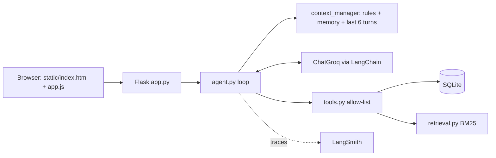

# Assignment 1: Intelligent Student Support Agent
Agentic AI Engineering, Assignment 1. **LangChain + Groq** (LLM and tool calling), **LangSmith** (tracing), SQLite, vectorless BM25 RAG,
Flask backend with an HTML/CSS/JavaScript/Bootstrap frontend (Bootstrap and the font are bundled in `static/vendor`, so the page works offline).
All students, fees and policies are **fictional demo data**.

> Assignment 2 (privacy, permissions, human approval, audit log) is the next folder, `../Assignment_2`. It extends this same agent.

## How it works

**Agent loop** (`agent.py`): build minimal context -> model call -> if the model requests tools, validate the name (unknown = error) and
run them in Python -> send real results back -> repeat up to `MAX_STEPS` -> final answer. Failures return controlled errors; nothing is invented.

| Requirement | Where |
|---|---|
| Agent loop | `agent.py` |
| Tools (fee, scholarship, ticket, policy search, save / read memory) | `tools.py` |
| Persistent memory | `memory.py` (SQLite, one row per student+key, blocks passwords/cards/OTP/long digit strings) |
| Vectorless RAG | `retrieval.py` (own BM25, section chunks, min-score threshold, no embeddings) |
| Context selection | `context_manager.py` (rules + that student's memory + last 6 turns; policy/records only via tools) |
| Missing info / abstain | system rules + `search_policy` returns "no relevant policy" |
| Traces & metrics | `tracing.py` (LangSmith + `logs/traces.jsonl`), `evaluate.py` |
| UI | `static/` (HTML, CSS, JS, Bootstrap) + `app.py` (Flask API) |

**Login:** students log in with ID + password (`/api/login`). Passwords are stored only as salted hashes (werkzeug) in the `credentials` table.
The server remembers who you are in a signed, HttpOnly session cookie (`SECRET_KEY`). Every chat/memory endpoint reads the student from that
cookie, never from the request, and the id is bound into the tools in Python (the tools take no student id argument), so the model cannot choose it.
Five wrong passwords lock that ID for a minute. Demo logins: S101/meet@123, S102/harsh@123, S103/neel@123.
(Access control, approval and audit beyond this are the subject of Assignment 2.)

## Setup (Windows)
```
python -m venv .venv
.venv\Scripts\Activate.ps1        (PowerShell)   or   .venv\Scripts\activate.bat   (CMD)
pip install -r requirements.txt
copy .env.example .env            (then edit .env; set GROQ_API_KEY and SECRET_KEY)
python scripts/initialize_db.py
```
`.env`: `GROQ_API_KEY` (from console.groq.com), `GROQ_MODEL` (default `llama-3.3-70b-versatile`; any Groq tool-calling model; check
console.groq.com/docs/models), and for tracing `LANGSMITH_TRACING=true`, `LANGSMITH_API_KEY`, `LANGSMITH_PROJECT`.
Without LangSmith keys the app works, tracing is just off.

## Run
```
python app.py                 # starts Waitress WSGI server on http://0.0.0.0:5000
python evaluate.py            # retrieval tests always; full agent tests (T01-T13) too if GROQ_API_KEY is set -> reports/evaluation.md + CSVs
python scripts/initialize_db.py --reset   # DEV ONLY: wipe and re-seed
```

## Cloud deployment (Render.com) and keep-alive
Render's free tier spins down idle services after 15-20 minutes. Built-in keep-alive:
1. When deployed on Render, `app.py` detects `RENDER_EXTERNAL_URL` and starts a background daemon thread that pings `/health` every 12 minutes.
2. `/health` returns a lightweight status (`{"status": "ok", "uptime_seconds": ...}`) with 0 LLM tokens.
3. Optional external pinger (cron-job.org or UptimeRobot) on `https://<your-service>.onrender.com/health` every 10 minutes.
4. Build: `pip install -r requirements.txt && python scripts/initialize_db.py`; start: `Procfile` (Gunicorn, `--workers 1 --threads 4`).

**Traces:** open smith.langchain.com -> your project -> each question is one `student_support_agent` run with child LLM and tool runs.
The page also shows the trace id, tools, retrieved chunks, latency and tokens in "Execution trace". LangSmith shows what happened; it does not prove an answer is correct. `evaluate.py` checks that separately.

## 5-minute demo
1. Log in as **S102** (harsh@123): "What is my fee balance?" (tool call, 40,000 outstanding).
2. "The payment portal failed. Can I pay on the next working day?" (policy found, extension NOT confirmed, offers ticket). Then "Yes, create a ticket" (ticket ID).
3. "Please remember my programme is PGDM Agentic AI." -> sidebar memory. Click **New conversation** or restart the app: ask "What programme am I in?"
4. "Remember my password is abc" -> rejected, nothing stored. "I am in a hurry right now" -> answered, not stored.
5. "What is the hostel refund rule?" -> handbook does not cover it, says so.
6. Show the LangSmith trace and `reports/evaluation.md`.

## Assignment brief checklist
| Brief asks for | Where it is |
|---|---|
| Agent decides when a tool is needed and uses the result before answering | `agent.py` loop: tool results are returned to the model before the final answer |
| At least two tools | fee status, scholarship status, create ticket, policy search, save / read memory (`tools.py`) |
| Persistent memory; temporary/sensitive data not stored | `memory.py` (SQLite; sensitive block-list; key/value validated; tests T05, T09, T13) |
| Retrieval from one handbook, only relevant parts | `retrieval.py` BM25 returns the top 3 sections above a score threshold, never the whole file |
| Context selection | `context_manager.py`: rules + that student's memory + last 6 turns; everything else fetched by tools on demand |
| Missing info / tool errors / unanswerable | controlled tool errors; "no relevant policy" result; tests T06, T07, T08, T11, T12 |
| Trace for each run | `logs/traces.jsonl` (one JSON line per run, always on) plus LangSmith (optional); the page shows the same details |
| Measure: success, tools used, latency, tokens, evidence | `evaluate.py` -> `reports/evaluation.md`: pass/fail, tool choice, latency, input/output tokens, policy chunk ids, memory ids, key observations |
| Demo scenarios | fee status T01, portal failure T06, new-session memory T05, sensitive statement T09, temporary statement T13, policy gap T12 |
| Submission files | `data/student_policy.txt`, `data/students.json`, this README, `reports/evaluation.md` |

`logs/traces.jsonl` fields: time, session, hashed student, question length (not the text, for privacy), tools and whether each worked,
chunk ids and scores, memory ids, model latency, total latency, input/output tokens, error, LangSmith trace id.
`reports/evaluation.md` is generated by `python evaluate.py`. The agent half says "NOT RUN" until you run it with your Groq key.

## Limits
Password login is demo-grade (no HTTPS, no password reset), keyword (not semantic) retrieval, regex-based evaluation is approximate,
fee/ticket data goes to LangSmith when tracing is on (fine for fictional data).

## Troubleshooting
- `GROQ_API_KEY is missing`: check `.env` is in the project folder.
- Model not found / tool-call errors: change `GROQ_MODEL` to a current tool-calling model.
- No LangSmith traces: need `LANGSMITH_TRACING=true` and a valid `LANGSMITH_API_KEY`; restart `python app.py` after editing `.env`.
- `no such table`: run `python scripts/initialize_db.py`.
