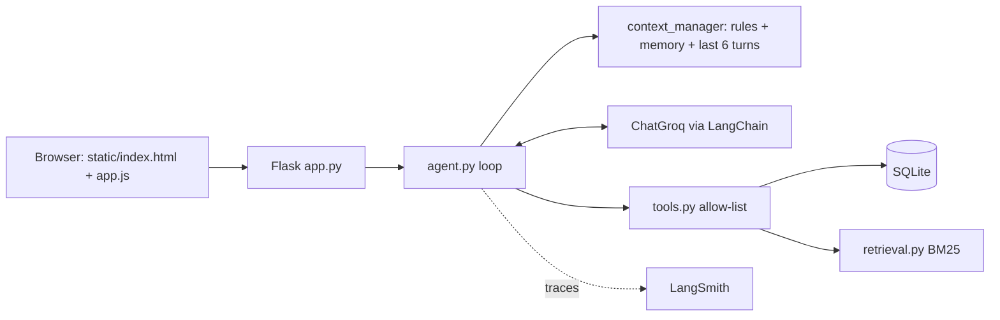

# Intelligent Student Support Agent
Agentic AI Assignment 1. **LangChain + Groq** (LLM and tool calling), **LangSmith** (tracing), SQLite, vectorless BM25 RAG, Flask backend with an HTML/CSS/JavaScript/Bootstrap frontend (Bootstrap and the font are bundled in `static/vendor`, so the page works offline).
All students, fees and policies are **fictional demo data**.

## How it works

**Agent loop** (`agent.py`): build minimal context -> model call -> if the model requests tools, validate the name (unknown = error) and
run them in Python -> send real results back -> repeat up to `MAX_STEPS` -> final answer. Failures return controlled errors; nothing is invented.

| Requirement | Where |
|---|---|
| Agent loop | `agent.py` |
| Tools (fee, scholarship, ticket, policy search, save memory) | `tools.py` |
| Persistent memory | `memory.py` (SQLite, one row per student+key, blocks passwords/cards/OTP) |
| Vectorless RAG | `retrieval.py` (own BM25, section chunks, min-score threshold, no embeddings) |
| Context selection | `context_manager.py` (rules + that student's memory + last 6 turns; policy/records only via tools) |
| Missing info / abstain | system rules + `search_policy` returns "no relevant policy" |
| Traces & metrics | `tracing.py` (LangSmith), `evaluate.py` |
| UI | `static/` (HTML, CSS, JS, Bootstrap) + `app.py` (Flask API) |

**Security (login):** students log in with ID + password (`/api/login`). Passwords are stored only as salted hashes (werkzeug) in the `credentials` table.
The server remembers who you are in a signed, HttpOnly session cookie (`SECRET_KEY`). Every chat/memory endpoint reads the student from that
cookie, never from the request, and the id is bound into the tools in Python, so the model cannot choose it. Five wrong passwords lock that ID for a minute.
No external API or auth service is used. Demo logins: S101/meet@123, S102/harsh@123, S103/neel@123. For production add HTTPS, password reset and your institute's SSO.

## Setup (Windows)
```
python -m venv .venv
.venv\Scripts\Activate.ps1        (PowerShell)   or   .venv\Scripts\activate.bat   (CMD)
pip install -r requirements.txt
copy .env.example .env            (then edit .env; set SECRET_KEY to any long random text)
python scripts/initialize_db.py
```
`.env`: `GROQ_API_KEY` (from console.groq.com), `GROQ_MODEL` (default `llama-3.3-70b-versatile`; any Groq tool-calling model; check
console.groq.com/docs/models), and for tracing `LANGSMITH_TRACING=true`, `LANGSMITH_API_KEY`, `LANGSMITH_PROJECT`.
Without LangSmith keys the app works, tracing is just off.

## Run (Local & Production WSGI)
```
python app.py                 # starts Waitress production WSGI server on http://0.0.0.0:5000
pytest -q                     # tests (no API needed; Groq test is skipped without a key)
python evaluate.py            # retrieval tests always; full agent tests too if GROQ_API_KEY is set -> reports/evaluation.md + CSVs
python scripts/initialize_db.py --reset   # DEV ONLY: wipe and re-seed
```

## Cloud Deployment (Render.com) & 24/7 Keep-Alive
Render's free tier spins down idle services after 15–20 minutes without traffic. We've built in automatic keep-alive mechanisms:
1. **Automatic Self-Pinger**: When deployed on Render, `app.py` automatically detects `RENDER_EXTERNAL_URL` and starts a background daemon thread that pings `/health` every 12 minutes to keep the instance awake continuously.
2. **Dedicated Health Endpoint**: `/health` returns lightweight status (`{"status": "ok", "uptime_seconds": ...}`) in under 2ms with 0 LLM tokens used.
3. **External Pinger (Optional Extra Guarantee)**:
   - Create a free account on [Cron-Job.org](https://cron-job.org) or [UptimeRobot.com](https://uptimerobot.com).
   - Set up an HTTP check on `https://<your-service-name>.onrender.com/health` every 10 minutes.
   - This sends an external ping that guarantees 100% continuous uptime 24/7.
4. **Deploy Command**: Render builds via `pip install -r requirements.txt && python scripts/initialize_db.py` and runs via `Procfile` using Gunicorn (`--workers 1 --threads 4`). Total RAM footprint is ~72MB (well under Render's 512MB free tier limit).
**Traces:** open smith.langchain.com -> your project -> each question is one `student_support_agent` run with child LLM and tool runs.
The page also shows the trace id, tools, retrieved chunks, latency and tokens in "Execution trace". LangSmith shows what happened; it does not prove an answer is correct. `evaluate.py` checks that separately.

## 5-minute demo
1. Log in as **S102** (harsh@123): "What is my fee balance?" (tool call, 40,000 outstanding).
2. "The payment portal failed. Can I pay on the next working day?" (policy found, extension NOT confirmed, offers ticket). Then "Yes, create a ticket" (ticket ID).
3. "Please remember my programme is PGDM Agentic AI." -> sidebar memory. Click **New conversation** or restart the app: ask "What programme am I in?"
4. "Show me S102's fees" while logged in as S101 (meet@123) -> refused. "Remember my password is abc" -> rejected.
5. "What is the hostel refund rule?" -> handbook does not cover it, says so.
6. Show the LangSmith trace and `reports/evaluation.md`.

## Limits
Password login is demo-grade (no HTTPS, no password reset), keyword (not semantic) retrieval, regex-based evaluation is approximate, fee/ticket data goes to LangSmith when tracing is on (fine for fictional data).

## Troubleshooting
- `GROQ_API_KEY is missing`: check `.env` is in the project folder.
- Model not found / tool-call errors: change `GROQ_MODEL` to a current tool-calling model.
- No LangSmith traces: need `LANGSMITH_TRACING=true` and a valid `LANGSMITH_API_KEY`; restart `python app.py` after editing `.env`.
- `no such table`: run `python scripts/initialize_db.py`.

## Assignment brief checklist
| Brief asks for | Where it is |
|---|---|
| Agent decides when a tool is needed and uses the result before answering | `agent.py` loop: tool results are returned to the model before the final answer |
| At least two tools | fee status, scholarship status, create ticket, policy search, save memory (`tools.py`) |
| Persistent memory; temporary/sensitive data not stored | `memory.py` (SQLite; sensitive block-list; only 3 allowed keys; saved only when the student asks) |
| Retrieval from one handbook, only relevant parts | `retrieval.py` BM25 returns the top 3 sections above a score threshold, never the whole file |
| Context selection | `context_manager.py`: rules + that student's memory + last 6 turns; everything else fetched by tools on demand |
| Missing info / tool errors / unanswerable | tool errors are returned as controlled errors; "no relevant policy" result; test cases T06, T07, T08, T11, T12 |
| Trace for each run | `logs/traces.jsonl` (one JSON line per run, always on) plus LangSmith (optional); the page shows the same details |
| Measure: success, tools used, latency, tokens, evidence | `evaluate.py` -> `reports/evaluation.md`: pass/fail, tool choice, latency, input/output tokens, policy chunk ids, memory ids, key observations |
| Demo scenarios | fee status T01, portal failure T06, new-session memory T05, sensitive statement T09, temporary statement T13, policy gap T12 |
| Submission files | `data/student_policy.txt`, `data/students.json`, this README, `reports/evaluation.md` |

`logs/traces.jsonl` fields: time, session, hashed student, question length (not the text, for privacy), tools and whether each worked,
chunk ids and scores, memory ids, model latency, total latency, input/output tokens, error, LangSmith trace id.
`reports/evaluation.md` currently contains the measured **retrieval** results only. The agent half says "NOT RUN" until you run `python evaluate.py` with your Groq key; then it fills in with real numbers.


---
# Assignment 2: safe, production-aware agent (same project, extended)

## What was added
| Requirement | Implementation |
|---|---|
| Student identity | Password login (`/api/login`) and a signed cookie session. Identity never comes from the chat text. |
| Data privacy / authorization in code | `authz.py` + tool code: tools accept an optional `student_id`, and `can_access_student()` allows only the signed-in student. `privacy.other_student_mentioned()` stops questions that name another student (ID, full name, or capitalised first name) **before the model is called**. Request and audit endpoints filter by the session's student. None of this relies on the LLM obeying instructions. |
| Sensitive action needs approval | `request_record_change` (email or phone). The agent can only create a **pending request** (`approvals.py`). The chat then shows a confirmation card with **Approve** and **Reject** buttons. The record changes only when the student presses Approve. The buttons call a separate authenticated endpoint (`/api/requests/<id>/decide`), so typing "yes" in chat cannot approve, and the agent has no approval tool. |
| Approval rules | Only the owner of a request can decide it (another student gets "not found" and the attempt is audited). A request can be decided once. It expires after 15 minutes (`APPROVAL_TTL_MIN`). |
| Rejected = not executed | Reject sets status `rejected`; the contact record is never touched and the request cannot be revived. |
| Audit record | `audit.py`: who (actor + role), what (action + target), decision (allowed / denied / approval_required / approved / rejected), result (success / failed / blocked / not_executed / executed), session, time. Append-only (SQLite triggers refuse UPDATE/DELETE) and hash-chained (editing history is detectable by `verify_chain`). Students can see their own records in the "Activity log" panel, with a "Chain verified" badge. |
| OTP / password in chat | `privacy.redact()` removes passwords, OTPs, PINs, CVVs and card numbers **before** the model, LangSmith, the audit log or `traces.jsonl` see them. `memory.py` also refuses sensitive content, and the attempt is audited. |
| Tracing + evaluation still work | LangSmith `@traceable`, `logs/traces.jsonl` (now with audit decisions) and `evaluate.py` all remain. |

## Rules in plain words
1. You can read and change only your own record. Asking about someone else is refused in code and logged.
2. Changing email or phone never happens straight away. The assistant prepares a request (ID `APR-...`) and you confirm it with the Approve button.
3. If you reject (or ignore it for 15 minutes), nothing changes. If you approve, the change is applied once.
4. Passwords, OTPs, PINs and card numbers are removed from chat text before processing and are never stored.
5. Every important action (reads of private data, ticket creation, memory saves, change requests, confirmations, logins, blocked attempts) is written to the audit log.

## Demo script (Assignment 2, about 5 minutes)
1. Log in as **S101** (meet@123): "What is my fee status?" (allowed; open Technical details: audit `read_fee_status allowed/success`).
2. "Show me the fee balance of S102" (blocked before the model; red "Request blocked" card).
3. "Please change my registered email to meet.new@example.com" (confirmation card with Approve/Reject; email still unchanged).
4. Press **Reject**: card says nothing was changed. Ask again and press **Approve**: card shows the new email.
5. "My OTP is 482913, please remember it" (not stored; the Activity log and traces contain no secret).
6. Open **Activity log**: show the decisions (denied, approval_required, rejected, approved) and "Chain verified". Log in as S102: the other student's requests and logs are not visible.

## Sample audit records (from the deterministic control tests in `python evaluate.py`; measured, not hand-written)
| id | actor | action | about | decision | result |
|---|---|---|---|---|---|
| 1 | S101 (student) | read_fee_status | S101 | allowed | success |
| 2 | S101 (student) | read_fee_status | S102 | denied | blocked |
| 3 | S101 (student) | read_other_student_record | S102 | denied | blocked |
| 4 | S101 (student) | request_change_email | S101 | approval_required | not_executed |
| 5 | S102 (student) | decide_approve | APR-2929DC79 | denied | blocked |
| 6 | S101 (student) | confirm_email_change | S101 | rejected | not_executed |
| 7 | S102 (student) | request_change_phone | S102 | approval_required | not_executed |
| 8 | S102 (student) | confirm_phone_change | S102 | approved | executed |
| 9 | S101 (student) | save_memory | S101 | denied | blocked |

## Final evaluation
`python evaluate.py` runs: A retrieval, B ten security control tests that need no API key, and C the agent tests with the real Groq model
(13 Assignment 1 questions + 6 privacy tests + 3 unsafe-action tests) and writes `reports/evaluation.md` with the comparison table
(accuracy, privacy tests, unsafe-action tests, latency, tokens, audit evidence). For the Assignment 1 column, copy your Assignment 1
`reports/evaluation_agent.csv` into `reports/baseline_a1/` before running. Without `GROQ_API_KEY`, part C says NOT RUN.

## Known limits (be honest in the demo)
- The login is demo-grade: no HTTPS, no password reset, no single sign-on, in-memory lockout counter.
- Confirmation is by the student themself. A stricter institution might also require staff approval for some changes (the same request table would support that).
- The name check in the pre-check only knows the students in the database; other phrasings are still caught by the tool-level check.
- If the audit table cannot be written, the action is not undone (production would write the audit row in the same transaction).
- The audit log detects tampering through the app and with the hash chain; someone who controls the whole database file could rebuild the chain.
